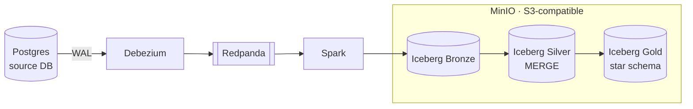

# ar-data-platform

<!-- Week 1 task: rewrite these 3 lines yourself, in English: problem, solution, result with a number. -->
**Problem:** analytics on operational databases usually means slow full reloads and numbers nobody can trace.
**Solution:** an open-source lakehouse that replicates a real Argentine public dataset with CDC into Apache Iceberg (Bronze → Silver → Gold), orchestrated, tested and costed.
**Result:** _coming in phase 1: e.g. "incremental MERGE of N changes/day in X minutes, with zero duplicates under out-of-order events"._

> Status: **Phase 1 · week 1** of a 52-week build. Each phase adds one layer to this repo.

## Architecture



Built so far: the source database (`source-db`). The rest of the diagram is the target for phase 1.

## Run it locally

Requirements: Docker Desktop (tested on Apple Silicon, 16 GB RAM) and `make`.

```bash
make up      # creates .env from .env.example and starts the stack
make psql    # opens a shell on the source database
make down    # stops it (make reset also deletes the data)
```

## Roadmap

| Phase | Layer | Status |
| --- | --- | --- |
| 1 | CDC ingestion: Postgres → Debezium → Iceberg (Bronze/Silver/Gold), SCD2 | in progress |
| 2 | Orchestration (Airflow) and transformation (dbt + DuckDB) | planned |
| 3 | Data quality, tests and CI | planned |
| 4 | Same case on Databricks + Delta, Spark tuning | planned |
| 5 | Streaming with Kafka/Redpanda + Structured Streaming | planned |
| 6 | AWS deployment with Terraform, costs, dashboard | planned |

## Decisions

Architecture decisions live in [`docs/adr/`](docs/adr/), one page each: context, options, decision, and what would make me change my mind.

- [ADR-000: Choosing the public dataset](docs/adr/000-dataset-selection.md) (proposed)

## What I would do differently in production

_Filled in as each layer lands: scale, cost, security, monitoring._

## Data

Only public Argentine open data (datos.gob.ar). No private or company data is used in this project.
